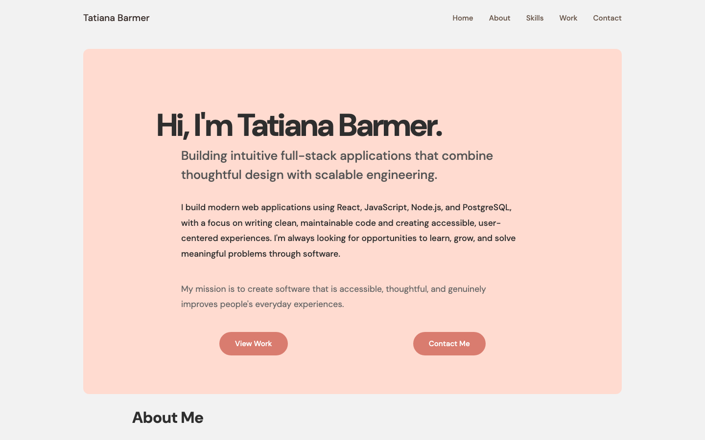
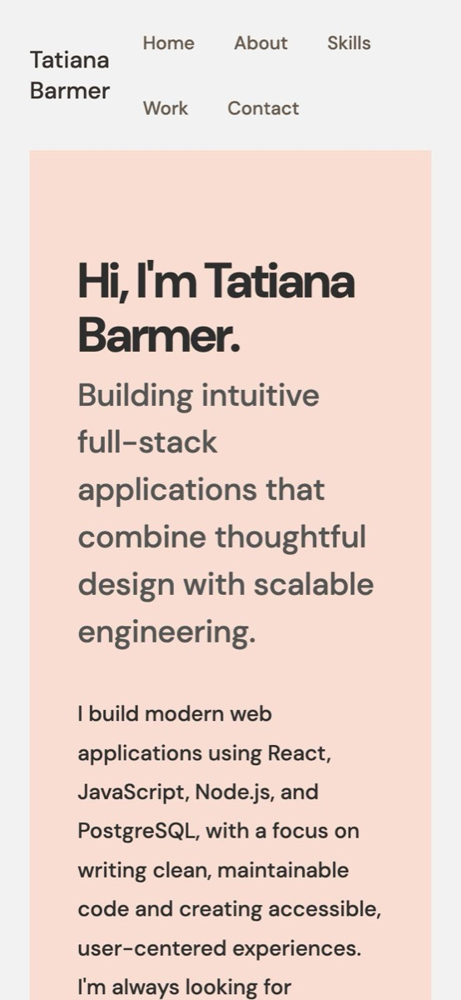
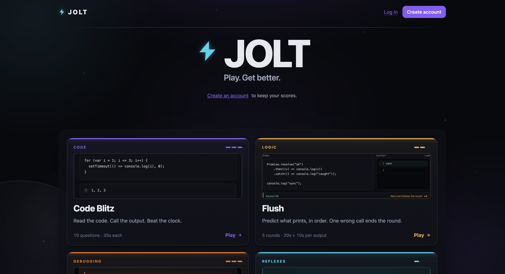
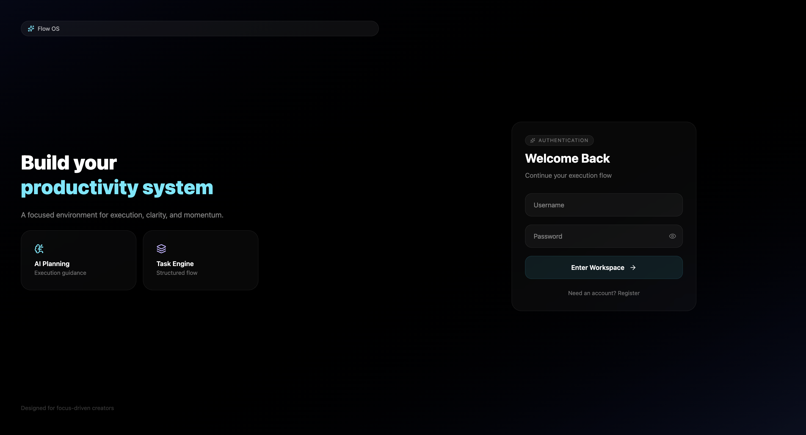
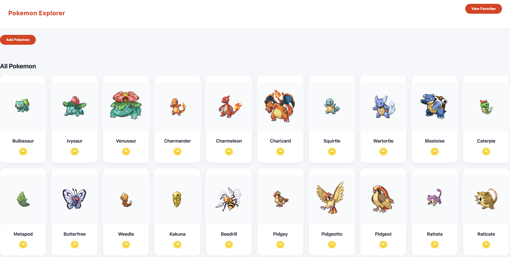
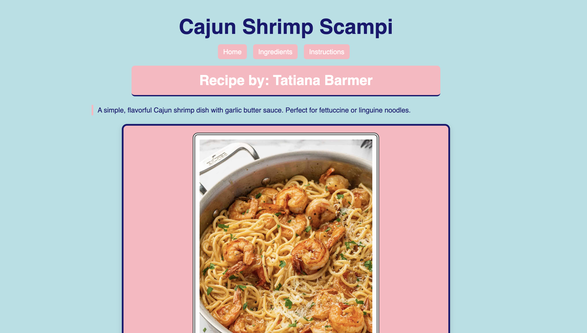
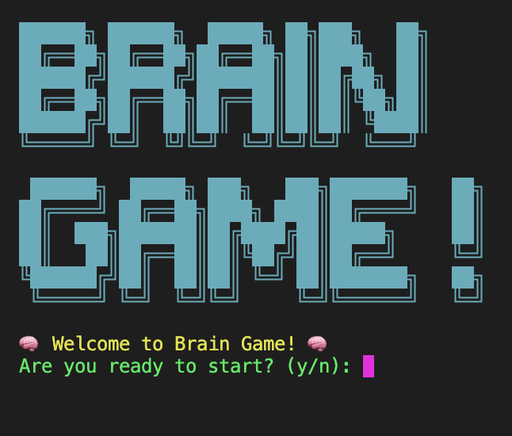

# Tatiana Barmer — Personal Portfolio

A responsive personal portfolio built with semantic HTML and CSS to introduce my work, share my software engineering journey, and make it easy to explore the projects I've built.

🌐 **[View the live portfolio](https://iamtati1.github.io/iamtati.github.io/)**

<p align="center">
  
  &nbsp;
  
</p>

## About

I'm a software engineer and product-minded developer who enjoys building thoughtful, accessible web experiences. This portfolio brings together my background, technical skills, and selected projects in one place.

## What's Inside

- **Introduction:** A short overview of my approach to software development.
- **About:** My path into software engineering and what motivates me.
- **Technical skills:** A snapshot of the languages, frontend tools, backend technologies, and developer tools I work with.
- **Projects:** Selected applications and coursework, with links to live demos and source code where available.
- **Contact:** A way to connect with me.

## Built With

- HTML5
- CSS3
- CSS Grid and Flexbox
- Responsive design
- Google Fonts
- Font Awesome

## Design & Implementation

The site uses semantic HTML to organize its sections and CSS to handle its visual design and responsive layouts. Flexbox supports alignment in components such as the navigation and action links, while CSS Grid creates flexible project and skills layouts.

The project cards use consistent spacing, borders, shadows, and hover transitions to make the content easier to scan. The layout is designed to adapt across desktop, tablet, and mobile screen sizes.

## Featured Work

A few projects currently represented in my portfolio:

<table>
  <tr>
    <td width="50%" valign="top">
      
      <h3>Jolt ⭐</h3>
      <p>A full-stack, game-based learning platform that turns JavaScript practice into fast, replayable challenges. React and TypeScript front end with an Express and PostgreSQL API and authentication.</p>
      <p><a href="https://jolt-4mjc.onrender.com/">Live demo</a> · <a href="https://github.com/iamtati1/game-night">Source</a></p>
    </td>
    <td width="50%" valign="top">
      
      <h3>TaskFlow ⭐</h3>
      <p>A full-stack task management application with authentication and a PostgreSQL-backed REST API.</p>
      <p><a href="https://taskflow-onrender-com.onrender.com">Live demo</a> · <a href="https://github.com/The-Marcy-Lab-School-Assignments/full-stack-project-remix-iamtati1">Source</a></p>
    </td>
  </tr>
  <tr>
    <td width="50%" valign="top">
      
      <h3>Pokédex Explorer</h3>
      <p>An API-driven application with Pokémon data, search, filtering, and dynamic rendering.</p>
      <p><a href="https://tati-uremu-mls.github.io/mod-4-project/">Live demo</a> · <a href="https://github.com/tati-uremu-mls/mod-4-project">Source</a></p>
    </td>
    <td width="50%" valign="top">
      
      <h3>Recipe Card App</h3>
      <p>A responsive recipe layout built with HTML and CSS Grid/Flexbox.</p>
      <p><a href="https://iamtati1.github.io/swe-3-1-two-recipe-card-iamtati1/">Live demo</a> · <a href="https://github.com/iamtati1/swe-3-1-two-recipe-card-iamtati1">Source</a></p>
    </td>
  </tr>
  <tr>
    <td width="50%" valign="top">
      
      <h3>CLI Quiz Game</h3>
      <p>A command-line quiz built with JavaScript fundamentals and Node.js.</p>
      <p><a href="https://github.com/iamtati1/swe-project-1-cli-app-v2">Source</a></p>
    </td>
    <td width="50%" valign="top"></td>
  </tr>
</table>

> Jolt and TaskFlow are hosted on Render's free tier, so the first visit can take up to a minute while the server wakes up.

See the [live portfolio](https://iamtati1.github.io/iamtati.github.io/) for the full project list.

## Run Locally

This is a static site, so no package installation or build step is required.

1. Clone the repository:

   ```bash
   git clone https://github.com/iamtati1/iamtati.github.io.git
   ```

2. Open the project folder.
3. Open `index.html` in your browser.

## Deployment

The site is hosted with **GitHub Pages**.

---

Built by [Tatiana Barmer](https://github.com/iamtati1).
